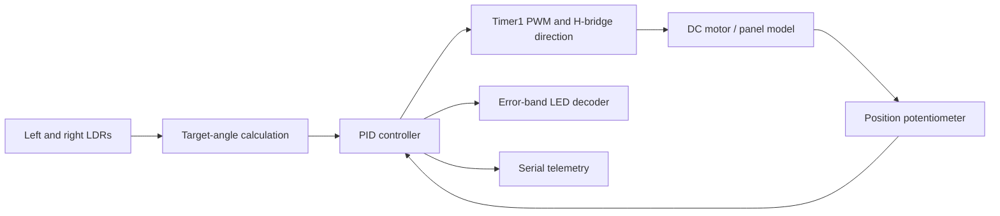

# PID Solar-Panel Tracker

An Arduino Uno control project that estimates a target angle from two light-dependent resistors and drives a simulated panel toward it using position feedback and a PID loop. Direct AVR register access configures the ADC, motor PWM and two output lines for an external four-LED error indicator.

The repository includes the original optimized sketch, an earlier sketch, the Proteus circuit and existing exported HEX files. **Source and file integrity were checked; a fresh build was blocked by the installed Windows AVR toolchain, and the simulation has not been rerun.** No tracking accuracy, energy gain or physical hardware performance is claimed.

## Control architecture



## Implementation

- LDR sampling scheduled every 50 ms (20 Hz).
- PID update scheduled every 10 ms (100 Hz).
- LED error indication scheduled every 250 ms (4 Hz).
- Serial telemetry scheduled every 1000 ms (1 Hz) at 9600 baud.
- Timer1 configured for 8-bit Fast PWM on D9, nominally 7812.5 Hz at a 16 MHz CPU clock.
- PID gains `Kp = 2.5`, `Ki = 0.01`, `Kd = 0.5`; integral clamped to ±100 and output to ±255.
- Optimized sketch suppresses integral accumulation when the previous output is saturated in the error's direction.
- A 0.8° error deadband stops the motor; outside it, the applied PWM magnitude is constrained to 25–255.
- `MOTOR_DIR_SIGN` provides a configurable motor-direction sign in the optimized sketch.

These are source-level implementation details and nominal scheduling intervals, not measured timing or verified closed-loop performance. There are no `delay()` calls, but ADC reads wait synchronously for conversion and the PID uses a fixed `DT = 0.01` rather than measured elapsed time.

## Source pin assignments

| Function | Uno pin / AVR peripheral |
| --- | --- |
| Left LDR divider | A0 / ADC0 |
| Right LDR divider | A1 / ADC1 |
| Panel-position feedback | A2 / ADC2 |
| Motor enable / speed | D9 / PB1 / OC1A |
| H-bridge IN1 | D8 / PB0 |
| H-bridge IN2 | D7 / PD7 |
| Error decoder A | D13 / PB5 |
| Error decoder B | D12 / PB4 |
| Serial telemetry | Hardware UART, 9600 baud |

The Proteus archive contains Uno/ATmega328P, LDR and L293D model references. Both source versions use the assignments above, but a full circuit connectivity check has not been performed. The design uses a DC motor with position feedback, rather than the pulse-command interface of a hobby PWM servo.

## Angle estimation and status indication

For divider ADC readings `n1` and `n2`, constrained to 1–1022, the sketch estimates:

```text
R1 = 10000 * (1023/n1 - 1)
R2 = 10000 * (1023/n2 - 1)

target = 70 * (R1 - R2) * 10000
         / (2*R1*R2 + (R1 + R2)*10000)
```

This follows the supplied exercise's LDR-angle relationship. Target angle is bounded to ±70°. Position ADC values 0–1023 map linearly to −70° through +70°. Neither relationship has been calibrated against a physical sensor/panel.

| Absolute error | Decoder A | Decoder B | Intended lit LEDs |
| --- | --- | --- | --- |
| Less than 5° | 1 | 1 | 4 |
| 5° to less than 10° | 1 | 0 | 3 |
| 10° to less than 15° | 0 | 1 | 2 |
| At least 15° | 0 | 0 | 1 |

The LED counts depend on the external decoder wiring; two GPIO pins do not directly drive four independent LEDs. Telemetry prints panel angle, target angle, error and the signed PID output. That output is not identical to the applied PWM after deadband and minimum-drive handling.

## Files

| Path | Contents |
| --- | --- |
| `firmware/SolarPanelControl_Optimized/` | Original optimized Arduino sketch, unchanged |
| `firmware/prebuilt/` | Existing optimized HEX export; historical artifact |
| `proteus/solar-panel-control.pdsprj` | Original circuit with a clearer repository filename |
| `archive/Task1/` | Earlier sketch and its existing HEX export |
| `docs/source-inventory.json` | Original-file hashes and integrity-check results |

The circuit's saved firmware property references an absolute path to the earlier `Task1.ino.hex`. Repoint it locally before simulation. The optimized and earlier sketches are separate revisions; the optimized sketch adds saturation handling, direction configuration and other implementation/documentation refinements.

## Build

Open `firmware/SolarPanelControl_Optimized/SolarPanelControl_Optimized.ino` in Arduino IDE and select **Arduino Uno** with the Arduino AVR Boards platform. The sketch uses Arduino core functionality and AVR headers; no third-party Arduino library is required.

With Arduino CLI, from the repository root:

```text
arduino-cli core install arduino:avr
arduino-cli compile --fqbn arduino:avr:uno --output-dir build/optimized firmware/SolarPanelControl_Optimized
```

The register definitions are specific to the Uno/ATmega328P configuration. Porting to a different board requires reviewing pins, registers, ADC assumptions and timer setup.

## Inspect in Proteus

1. Open `proteus/solar-panel-control.pdsprj` in a compatible Proteus installation with the Uno model library used by the original circuit.
2. Check the source pin table against the schematic and verify the 16 MHz clock and position-feedback wiring.
3. Point the Uno's Program File property to a freshly built HEX. Existing HEX exports are also included for historical reproduction, but their correspondence to the current source was not re-established by a fresh build.
4. The exercise specifies the DC servo motor model with travel limits −70° to +70° and moment of inertia 0.7; verify those model properties before testing.
5. Open the virtual terminal at 9600 baud. Vary the two LDR inputs and observe target angle, panel position, error and motor command.
6. Check direction polarity, deadband, LED transitions, saturation recovery and travel limits. Record results before claiming successful tracking.

## Verification and remaining work

All five original files were copied unchanged and compared with SHA-256. The Proteus ZIP archive passed its internal integrity check and its project XML parsed. Both historical HEX exports passed Intel HEX record-length, checksum, EOF and flash-address checks.

A fresh Uno build was attempted on 21 October 2026 using Arduino CLI 1.5.1 and Arduino AVR Boards 1.8.8. Windows could not launch the installed `avr-g++` executable because of an **Illegal System DLL Relocation** error. This is a toolchain-launch failure, not a successful compile or a source compilation result. See [verification details](docs/verification.md).

Simulation behavior, controller tuning, timing jitter, motor polarity, LED circuitry and sensor calibration remain unverified. The proportional/derivative behavior, minimum drive and noise sensitivity should be evaluated with a representative model. Software angle bounds are not independent physical end-stop protection.
